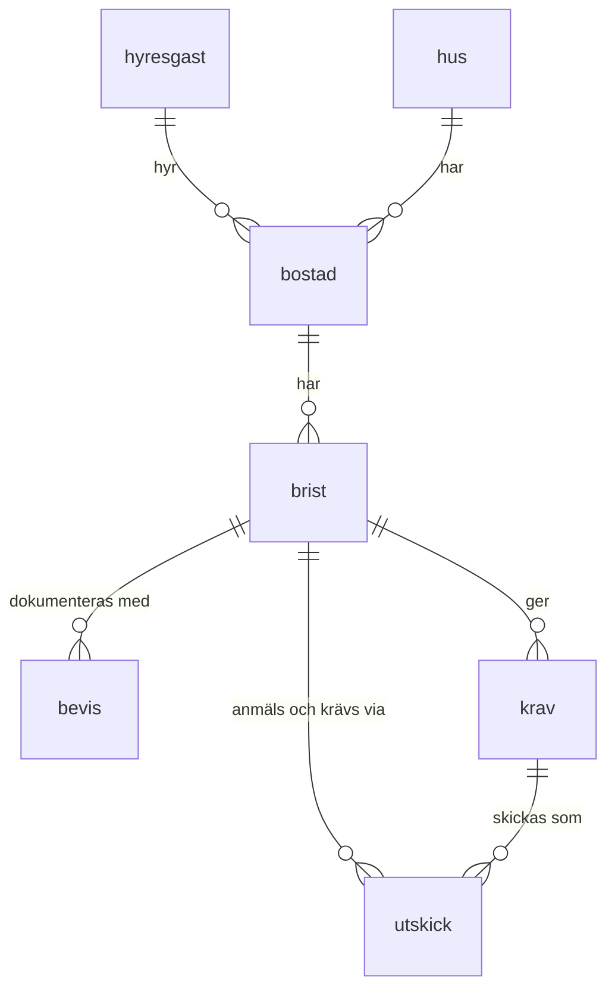

# Datamodell för fas 2–4 (förslag – inte byggd)

Förslaget utgår från Supabase (Postgres, EU-region) med Supabase Auth för konton och Supabase Storage för filer.
Tabellnamnen är på svenska och utan å, ä och ö, som `vantelista` i fas 1.

## Översikt

## Tabeller

### hyresgast
En rad per konto. `id` är samma som `auth.users.id`.

| Kolumn | Typ | Kommentar |
| --- | --- | --- |
| id | uuid, PK, FK → auth.users | |
| namn | text | Behövs i anmälan och kravbrev |
| epost | text | Kopia från Auth, för utskick |
| telefon | text, null | Frivilligt |
| samtycke_version | text | Vilken integritetspolicy som godkändes |
| skapad | timestamptz | |
| raderad | timestamptz, null | Mjuk radering innan den riktiga raderingen |

### hus
En fastighet eller ett trapphus. Används för att gruppera ärenden i fas 4.

| Kolumn | Typ | Kommentar |
| --- | --- | --- |
| id | uuid, PK | |
| gatuadress_normaliserad | text | T.ex. `storgatan 12` – gemener, utan extra mellanslag |
| postnummer | text | 5 siffror |
| ort | text | |
| hyresvard_namn | text, null | |
| hyresvard_epost | text, null | Felanmälans adress, delas mellan grannar |
| skapad | timestamptz | |

Unikt index på (`gatuadress_normaliserad`, `postnummer`).

### bostad
Hyresgästens lägenhet.

| Kolumn | Typ | Kommentar |
| --- | --- | --- |
| id | uuid, PK | |
| hyresgast_id | uuid, FK | |
| hus_id | uuid, FK | |
| lagenhetsnummer | text | |
| manadshyra | numeric(10,2) | |
| forstahandskontrakt | boolean | Tjänsten är bara för förstahandskontrakt |
| hyresvard_epost | text, null | Om den skiljer sig från husets |
| skapad | timestamptz | |

### brist

| Kolumn | Typ | Kommentar |
| --- | --- | --- |
| id | uuid, PK | |
| bostad_id | uuid, FK | |
| typ | text | Samma id:n som `BRISTTYPER` (`kyla`, `renovering` …) |
| beskrivning | text | |
| upptackt | date | När bristen började |
| status | text | `oppen`, `anmald`, `atgardad`, `avslutad` |
| atgardad | date, null | |
| dela_med_grannar | boolean, default false | Aktivt val (fas 4) |
| skapad | timestamptz | |

Anmälningsdatumet räknas fram från det första lyckade utskicket av typen `anmalan`. Då kan det inte ändras i efterhand.

### bevis
Bristdagboken. Raderna ändras aldrig – rättelser blir nya rader.

| Kolumn | Typ | Kommentar |
| --- | --- | --- |
| id | uuid, PK | |
| brist_id | uuid, FK | |
| typ | text | `foto`, `temperatur`, `anteckning`, `dokument` |
| tidpunkt | timestamptz | Vad användaren anger, t.ex. när fotot togs |
| registrerad | timestamptz, default now() | Serverns tid – den som gäller som bevis |
| temperatur_c | numeric(4,1), null | För `temperatur` |
| text | text, null | |
| fil_sokvag | text, null | Sökväg i en privat Storage-bucket |
| sha256 | text, null | Kontrollsumma för filen, visar att den inte har ändrats |

Ta bort EXIF-data med GPS-position från foton innan de sparas (integritet).

### utskick
Första versionen finns redan som tabellen `anmalan` (fas 2, se `supabase/schema.sql`). Den kopplas till `brist` när
konton finns.

Allt vi skickar till hyresvärden. Raderna ändras aldrig (append only). Bara leveransstatus uppdateras, i en egen
tabell eller kolumn.

| Kolumn | Typ | Kommentar |
| --- | --- | --- |
| id | uuid, PK | |
| brist_id | uuid, FK | |
| krav_id | uuid, FK, null | Om utskicket är ett kravbrev |
| typ | text | `anmalan`, `krav`, `paminnelse` |
| mottagare_epost | text | |
| kopia_till_hyresgast | boolean | Hyresgästen får alltid en kopia |
| amne | text | |
| innehall | text | Exakt det som skickades |
| sha256 | text | Kontrollsumma för innehållet |
| skickad | timestamptz | |
| leverantor_id | text | Meddelande-id från e-posttjänsten |
| leveransstatus | text | `skickad`, `levererad`, `studsad` |
| pdf_sokvag | text, null | Arkivkopia |

### krav
Ett krav på nedsättning för en period (fas 3).

| Kolumn | Typ | Kommentar |
| --- | --- | --- |
| id | uuid, PK | |
| brist_id | uuid, FK | |
| period_fran | date | Anmälningsdatum |
| period_till | date | Åtgärdat eller dagens datum |
| procent_min, procent_max | numeric | |
| belopp_min, belopp_max | integer | Kronor |
| procentsatser_version | text | Vilken version av procenttabellen som användes |
| status | text | `utkast`, `betalt`, `skickat`, `besvarat`, `avslutat` |
| stripe_checkout_id | text, null | |
| pris_ore | integer, null | 19 500–39 500 |
| pdf_sokvag | text, null | |
| skapad | timestamptz | |

### vantelista (finns redan)
Se `supabase/schema.sql`. Bjud in till fas 2 och radera sedan raden när personen har skapat konto eller tackat nej.

## Behörighet (RLS)

- `hyresgast`, `bostad`, `brist`, `bevis`, `utskick`, `krav`: en hyresgäst ser bara sina egna rader
  (`auth.uid()` via kedjan bostad → hyresgast).
- `utskick` och `bevis`: insert men inte update eller delete för hyresgästen. Det skyddar bevisvärdet.
- `hus`: läsbar för inloggade bara via en vy med sammanställningar (fas 4).
- Admin: en egen roll med en `is_admin()`-kontroll. Logga varje adminåtgärd i `handelselogg` (vem, vad, när).

## Fas 4: grannar på samma adress

En vy `hus_sammanstallning` räknar antal **olika hyresgäster** per hus och bristtyp, men bara bland brister med
`dela_med_grannar = true`. Den visar bara ett antal när det är minst 3. Inga namn eller lägenhetsnummer delas.

## Gallring och radering

- Radering på begäran: konto, bostad, brister och bevis raderas. Om `utskick` som har skickats till en hyresvärd ska
  sparas längre som bevis för hyresgästen själv är en fråga till juristen (se docs/JURIST-TODO.md).
- Filer i Storage raderas tillsammans med raden som pekar på dem.
